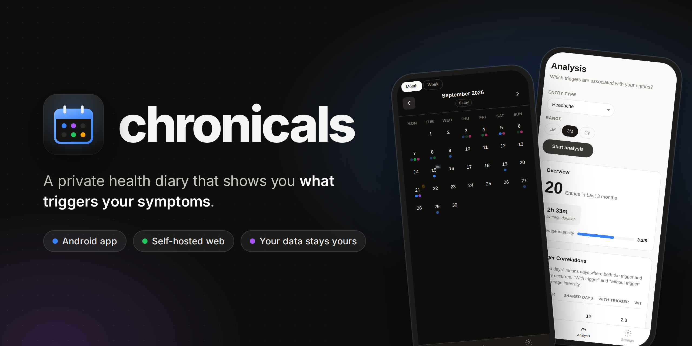
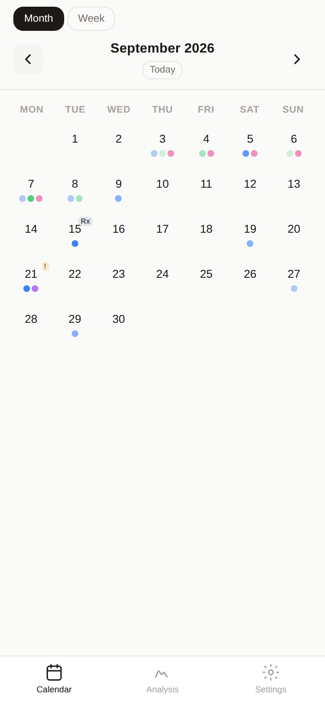
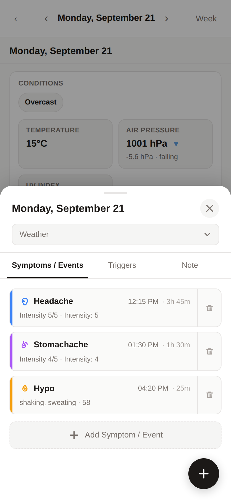
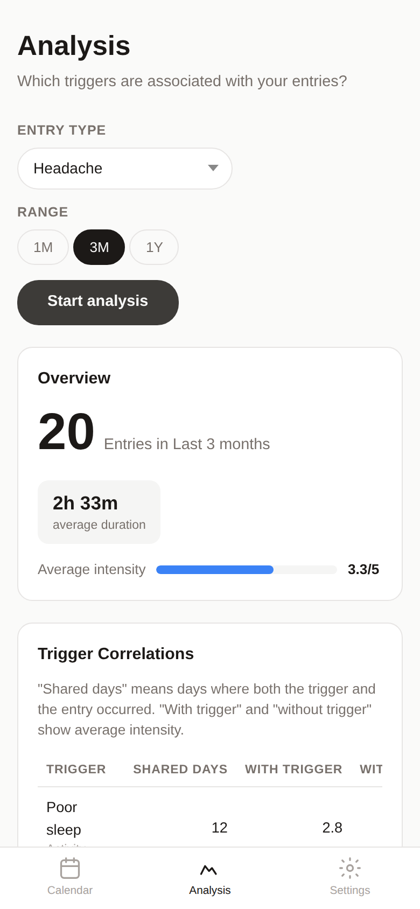
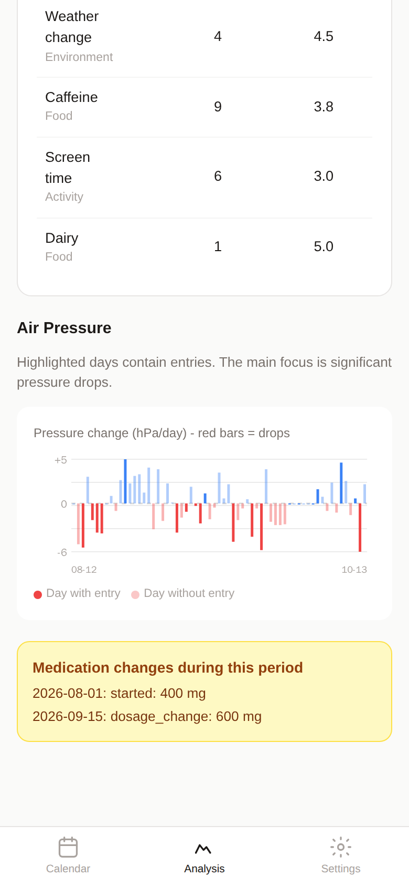
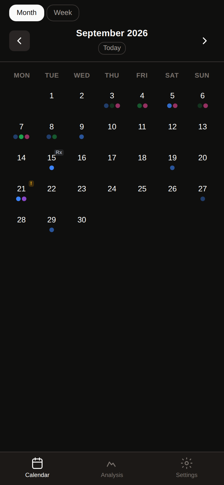
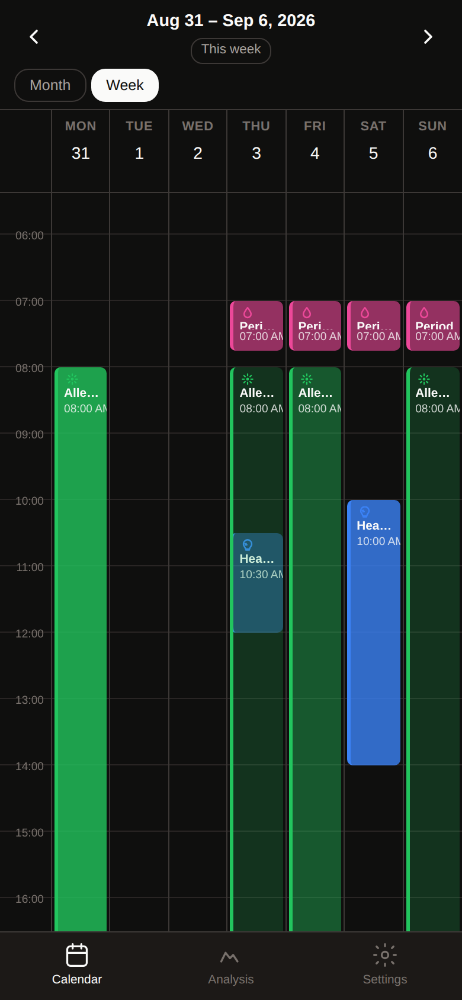
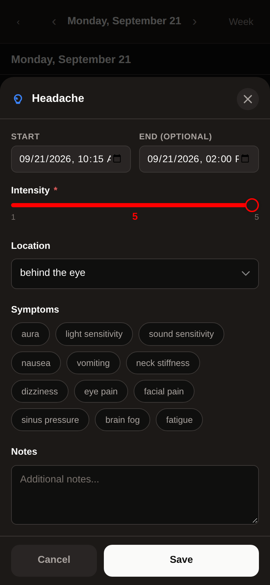
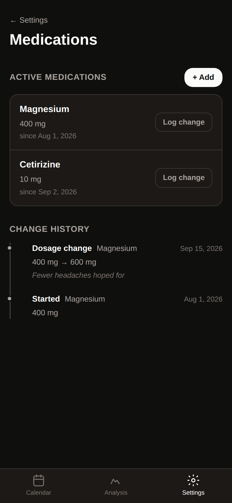

<p align="center">
  
</p>

<p align="center">
  
  
  
  
</p>

**chronicals** is a calendar-based health diary. Log headaches, stomach aches, allergies, hypos, periods and medication changes, along with the things that may have caused them: sleep, stress, food, weather. chronicals then shows you which of those actually line up with your symptoms.

It runs in two ways, both from this repository:

- 📱 **Android app**: everything stays on your phone. No account and no server.
- 🖥️ **Self-hosted web app**: one Docker container with a SQLite file, installable as a PWA.

## Screenshots

<table>
  <tr>
    <td></td>
    <td></td>
    <td></td>
    <td></td>
  </tr>
  <tr>
    <td></td>
    <td></td>
    <td></td>
    <td></td>
  </tr>
</table>

## Features

| | |
|---|---|
| 🗓️ **Calendar first** | Month, week and day views. Each symptom type has its own colour, and its intensity sets the shade. |
| 🩺 **Built-in entry types** | Headache, stomach ache, allergy / hay fever, hypo, period, medication change and notes, each with its own form (intensity, location, symptoms…). |
| 🧩 **Your own entry types** | Define new types with sliders, selects, checklists and text fields. |
| ⚡ **Triggers** | Tag days with food, environment and activity triggers, or add your own. |
| 🌦️ **Automatic weather** | Temperature, air pressure, pressure change and UV index for your location, from [Open-Meteo](https://open-meteo.com). |
| 📈 **Analysis** | Phi-coefficient correlations between symptoms and triggers or weather, an air-pressure chart, and medication changes marked over the same period. |
| 💊 **Medications** | Active medications with a dosage-change history. |
| 🌗 **Light & dark, 🇬🇧 / 🇩🇪** | Follows your system theme. English and German. |

## Get it

### 📱 Android

1. Download the latest `chronicals-x.y.z.apk` from **[Releases](../../releases/latest)**.
2. Open it on your phone. Android asks you to allow installs from your browser or file manager the first time.
3. Updates install over the existing app and keep your data.

Your diary is stored inside the app's private storage. Nothing is sent anywhere except weather requests to Open-Meteo, and only once you set a location. Android's automatic backup includes the app's data if backup is turned on for your Google account.

### 🖥️ Self-hosted (Docker)

```bash
git clone https://github.com/stub1t/Chronicals.git chronicals
cd chronicals
docker compose up -d
```

Open <http://localhost:3000>. The SQLite database lives in the `chronicals_data` volume.

| Variable | Default | |
|---|---|---|
| `ORIGIN` | `http://localhost:3000` | The public URL you reach the app at (needed for CSRF protection behind a reverse proxy) |
| `DATABASE_PATH` | `/data/chronicals.db` | SQLite file location inside the container |
| `PORT` | `3000` | Port the server listens on |

## Development

```bash
npm install
npm run dev              # http://localhost:5173
npm run check            # svelte-check
npm run build            # Node server build → build/
```

<details>
<summary><b>Building the Android app locally</b></summary>

Requires JDK 21 and the Android SDK (platform 36).

```bash
npm run android:sync                     # static build → build-mobile/ → android/
cd android && ./gradlew assembleDebug    # app/build/outputs/apk/debug/app-debug.apk
npm run android:open                     # or open the project in Android Studio
```

</details>

<details>
<summary><b>How one codebase serves both</b></summary>

All data access lives in `src/lib/data` as synchronous Drizzle queries, and every `/api/*` route is defined once in `src/lib/data/api.ts`.

- **Web:** the SvelteKit server mounts that route table and runs the queries on `better-sqlite3`.
- **Android:** the app is a static SPA. The same route table answers in-process, the queries run on `sql.js` (SQLite compiled to WebAssembly), and the database is saved to app storage after every change.

Migrations in `migrations/` are applied on both. See [`AGENTS.md`](AGENTS.md) for the conventions to follow when changing things.

</details>

## Releasing

Pushing a version tag builds a signed APK and publishes it as a GitHub Release ([`.github/workflows/android-release.yml`](.github/workflows/android-release.yml)):

```bash
git tag v0.1.0
git push origin v0.1.0
```

<details>
<summary><b>One-time setup: signing secrets</b></summary>

The workflow signs with a release keystore that is **never committed**. Keep `.signing/` (or wherever your keystore lives) backed up: an APK signed with a different key can't update an installed app.

Add four repository secrets, either with the GitHub CLI from the repository root:

```bash
base64 < .signing/chronicals-release.jks | tr -d '\n' | gh secret set ANDROID_KEYSTORE_BASE64
awk '/Store password/{print $3}' .signing/credentials.txt | gh secret set ANDROID_KEYSTORE_PASSWORD
awk '/Store password/{print $3}' .signing/credentials.txt | gh secret set ANDROID_KEY_PASSWORD
gh secret set ANDROID_KEY_ALIAS --body chronicals
gh secret list   # should show all four
```

…or in the browser under **Settings → Secrets and variables → Actions → New repository secret**, using these values:

| Secret | Value |
|---|---|
| `ANDROID_KEYSTORE_BASE64` | Output of `base64 < .signing/chronicals-release.jks \| tr -d '\n'` |
| `ANDROID_KEYSTORE_PASSWORD` | *Store password* from `.signing/credentials.txt` |
| `ANDROID_KEY_PASSWORD` | Same as the store password |
| `ANDROID_KEY_ALIAS` | `chronicals` |

To rebuild an existing tag, go to **Actions → Android release → Run workflow**.

</details>
