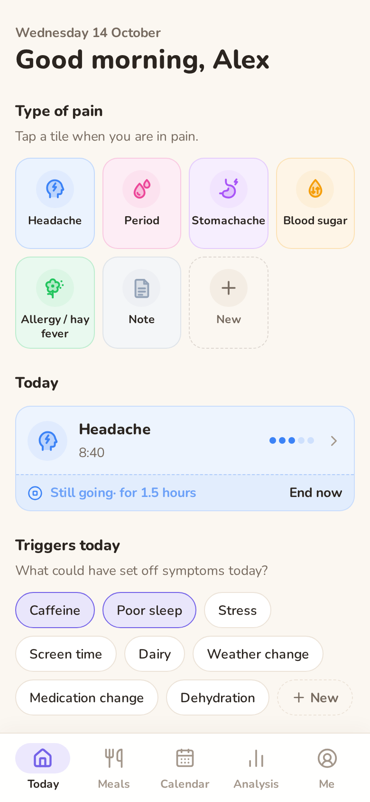
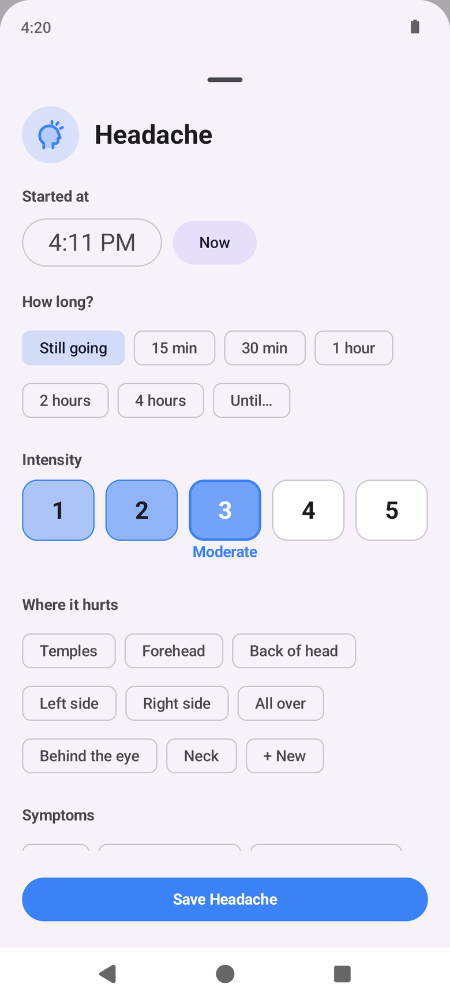
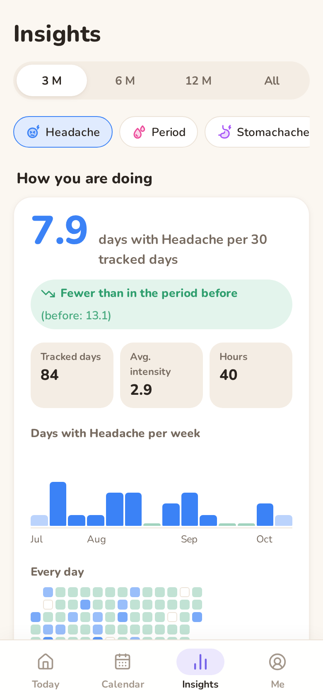
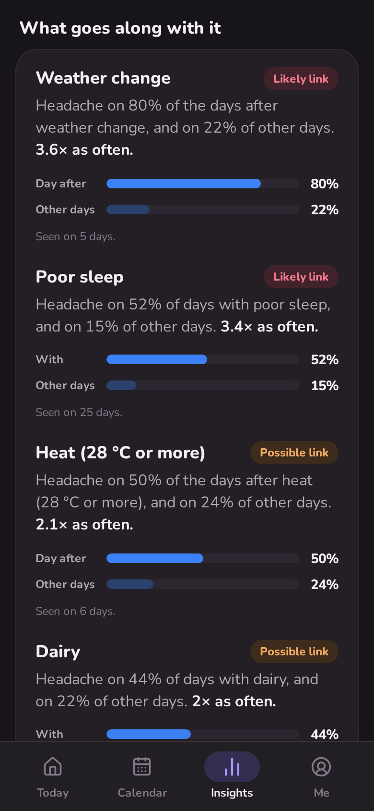
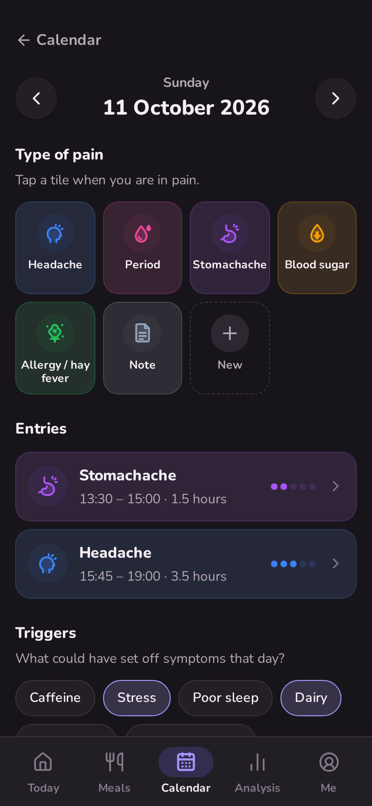
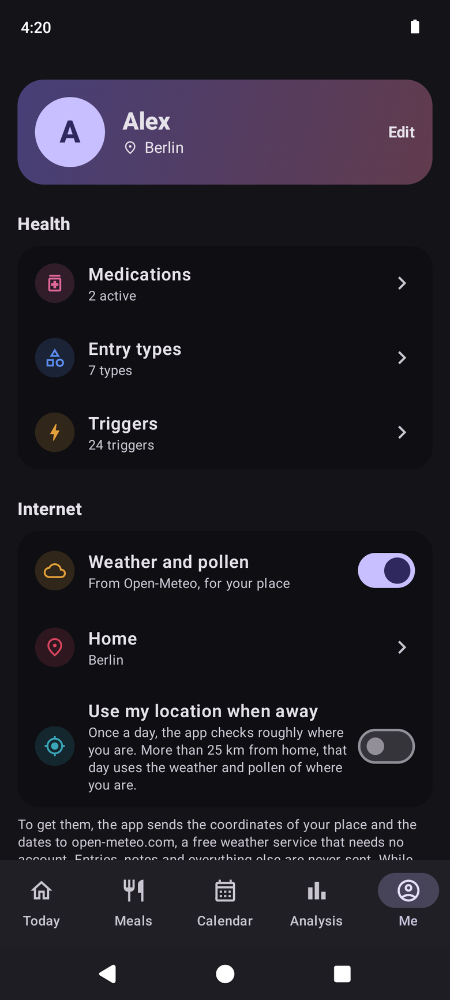
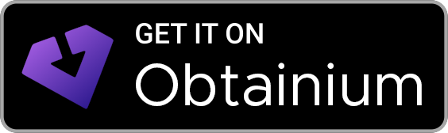

<p align="center">
  
</p>

# Chronicals

Chronicals is a symptom diary. Each day you note how you feel, log symptoms such as headaches or stomach aches, and tap what happened, for example poor sleep, stress or caffeine. Over time the app shows which of those things go along with your symptoms, when the symptoms tend to come, and whether a medication change made a difference.

It runs as an Android app that keeps all data on the phone, or as a web app that you host yourself with Docker.

<table>
  <tr>
    <td></td>
    <td></td>
    <td></td>
    <td></td>
  </tr>
  <tr>
    <td></td>
    <td></td>
    <td></td>
    <td></td>
  </tr>
</table>

## Features

- Today as the home screen: rate how you feel on five faces, log a symptom in two taps, end one that is still going, tap the day's triggers, see the weather and write a note.
- Calendar with a month view tinted by your symptoms and mood, a week list and a page for each day. Search finds days by note, symptom, form value or trigger.
- Seven built-in entry types: headache, stomachache, allergy or hay fever, low blood sugar, medication change, period and note. Each has its own form. A headache entry, for example, asks for intensity, location and accompanying symptoms.
- Your own entry types with a name, icon and colour, recording intensity (1 to 5) and a note. Any type you don't use can be hidden from Today.
- Triggers in four groups: food, environment, activity and your own.
- Daily weather from [Open-Meteo](https://open-meteo.com): temperature, air pressure and its change since the day before, UV index and conditions. This needs a location in your profile.
- Insights: how you are doing compared with the period before, which triggers and weather go along with a symptom, when it happens, and how the weeks around a medication change compare. See below.
- A medication list with dose changes and their history.
- A doctor report for any period, to print or save as a PDF from the print dialog, and every entry as a CSV spreadsheet.
- In the Android app, optional reminders (a daily one and per medication) and an optional app lock.
- English and German, light and dark theme.

## How Insights works

Insights looks at one entry type over 3, 6 or 12 months or everything. Only days with some record count: a log, a trigger, a note or a mood rating. A day you didn't open the app is left out instead of being counted as a day without symptoms.

The first card shows days with the symptom per 30 recorded days, compared with the period of the same length just before. It says "fewer" or "more" when the rate changed by at least a fifth and by at least one day a month. Below are the average intensity, the hours with the symptom, a bar per week, every day in a grid and your weekly mood.

The second card compares, for each trigger, the share of days with the symptom when the trigger was there with the share on all other days. Each trigger is checked for the same day and for the day after, and the stronger of the two is shown. Air pressure drops of 5 hPa or more, days of 28 °C or more and a UV index of 6 or more are checked the same way. A one-sided [Fisher exact test](https://en.wikipedia.org/wiki/Fisher%27s_exact_test) decides the label: "likely link" below p = 0.05 with at least 1.5 times as many symptom days, "possible link" below p = 0.2 with at least 1.25 times as many, and "fewer symptoms" when the symptom is clearly rarer with the trigger. With fewer than 5 days on either side, a trigger is listed under "not enough days yet".

The third card shows the share of days with the symptom per weekday, the time of day it started and, with at least two logged periods, the phase of the cycle: the 3 days before, period days 1 to 3, later period days and other days.

The last card puts the 30 days before each medication start or dose change next to the 30 days after, once both sides have at least 10 recorded days.

These are patterns in your own diary, not proof of a cause and not medical advice. Several triggers checked at once will sometimes show a link by chance, so a link that holds up over a few months means more than one that appears in a single month.

## Installation

### Android

Android 7.0 or newer is required. There are two ways to install the app.

#### With Obtainium

[Obtainium](https://obtainium.imranr.dev) installs the app from the GitHub releases and updates it when a new release comes out. Open this link on the phone:

<a href="https://apps.obtainium.imranr.dev/redirect?r=obtainium://app/%7B%22id%22%3A%22io.github.stub1t.chronicals%22%2C%22url%22%3A%22https%3A%2F%2Fgithub.com%2Fstub1t%2FChronicals%22%2C%22author%22%3A%22stub1t%22%2C%22name%22%3A%22Chronicals%22%2C%22additionalSettings%22%3A%22%7B%5C%22includePrereleases%5C%22%3Afalse%2C%5C%22versionDetection%5C%22%3Atrue%2C%5C%22allowedSigningCertHashes%5C%22%3A%5C%2204%3A3F%3AE1%3AE2%3A27%3AFE%3A49%3A75%3A30%3A8F%3A2B%3AE3%3A64%3A89%3AA8%3A0D%3AFF%3A3F%3AD8%3A6A%3A47%3AB3%3A04%3A9F%3AC5%3A88%3A05%3A22%3A20%3ACA%3ABD%3A89%5C%22%7D%22%7D"></a>

It opens Obtainium with the app already filled in. It also sets the expected signing certificate, so Obtainium refuses an APK that was signed with a different key. Instead of the link you can tap Add App in Obtainium and enter `https://github.com/stub1t/Chronicals`.

#### Manual download

Download `chronicals-<version>.apk` from the [latest release](../../releases/latest) and open it on the phone. Android asks once for permission to install apps from your browser or file manager. Repeat this for each new version.

Either way, a new version installs over the old one and keeps your entries.

The diary is stored in the app's private storage. Android's device backup includes it if backup is turned on. Uninstalling the app deletes the data, so export a backup first (see [Backups](#backups)).

The app only contacts Open-Meteo: for the place search in the profile settings, and for weather data once a location is saved.

### Self-hosted web app

```bash
git clone https://github.com/stub1t/Chronicals.git
cd Chronicals
docker compose up -d
```

The app is then available at <http://localhost:3000>. The SQLite database is stored in the Docker volume `chronicals_data`. Browsers can install the web app as a PWA.

| Variable | Default | Description |
|---|---|---|
| `ORIGIN` | `http://localhost:3000` | Public URL of the app. Set it when running behind a reverse proxy, otherwise changes are rejected by the CSRF check. |
| `DATABASE_PATH` | `/data/chronicals.db` | Location of the SQLite file inside the container |
| `PORT` | `3000` | Port the server listens on |
| `ALLOWED_HOSTS` | empty | Extra host names the server answers to, comma-separated |
| `BODY_SIZE_LIMIT` | `50M` in the Docker image | Largest accepted upload. Backups are uploaded in one request. |

The server only answers requests addressed to the host name in `ORIGIN`, `localhost` or an IP address, and returns 421 for anything else. This blocks DNS rebinding, where a malicious website points its own domain at your server to read the diary through your browser. If a reverse proxy forwards a different host name, add that name to `ALLOWED_HOSTS`.

## Reminders and app lock

Both are only in the Android app and are off until you turn them on under Me.

- The daily reminder asks you to log your day at a time you choose. Each medication can have up to six reminder times; they stop when the medication is stopped. Android may deliver a reminder a few minutes late, because the app does not use exact alarms.
- The app lock asks for your fingerprint, face or the phone's screen lock when the app opens and after more than a minute in the background. While it is on, the app is hidden in the recent apps view and screenshots are blocked. It keeps someone holding your unlocked phone out of the diary. It does not encrypt the data.

## Backups

The Data section under Me has two buttons:

- Export backup saves the whole database as one SQLite file, `chronicals-YYYY-MM-DD.db`. The web app downloads it. The Android app opens the share sheet, from where the file can be saved to Files or Google Drive or sent somewhere else.
- Import backup replaces all data with the contents of such a file, after a confirmation.

The same file works in the Android app and the web app, so a backup can also move the diary from the server to the phone or back. Older backups are upgraded to the current database version during import. Files from a newer version of Chronicals, damaged files and other SQLite databases are refused.

## Development

```bash
npm install
npm run dev     # development server on http://localhost:5173
npm run check   # type check
npm test        # unit tests (vitest)
npm run build   # production build of the web app
```

The tests run with the time zone set to Pacific/Auckland, so date bugs from converting local dates to UTC show up. GitHub Actions runs the type check, the tests, both builds and a debug Android build on every push.

Building the Android app needs JDK 21 and the Android SDK with platform 36:

```bash
npm run android:sync                    # builds the web assets and copies them into android/
cd android && ./gradlew assembleDebug   # APK in android/app/build/outputs/apk/debug/
```

Both versions share the same code. The database queries live in `src/lib/data` and every `/api` route is defined once in `src/lib/data/api.ts`. The web server runs them against SQLite through `better-sqlite3`. The Android app is a static build that answers the same routes inside the app with `sql.js`, a WebAssembly build of SQLite, and saves the database file after each change. [`AGENTS.md`](AGENTS.md) describes the conventions in more detail.

## Releases

Release versions are dates in UTC, for example `v2026.10.13`. A second release on the same day becomes `v2026.10.13.2`. To publish a release from `main`:

```bash
npm run release   # starts the "Android release" workflow
gh run watch      # optional: follow the build, which takes about four minutes
```

The workflow can also be started from the Actions tab. It builds and signs the APK, creates the tag and publishes the release with notes generated from the commits. To build the APK of an existing release again, run `gh workflow run android-release.yml -f rebuild_tag=v2026.10.13`.

## License

Copyright (C) 2026 stub1t

Chronicals is free software: you can redistribute it and/or modify it under the terms of the GNU Affero General Public License as published by the Free Software Foundation, either version 3 of the License, or (at your option) any later version. See [`LICENSE`](LICENSE).

If you run a modified version as a web service, the AGPL requires you to offer your users its source code. The About section under Me links to the source of this repository; point it at your fork if you change the code.
